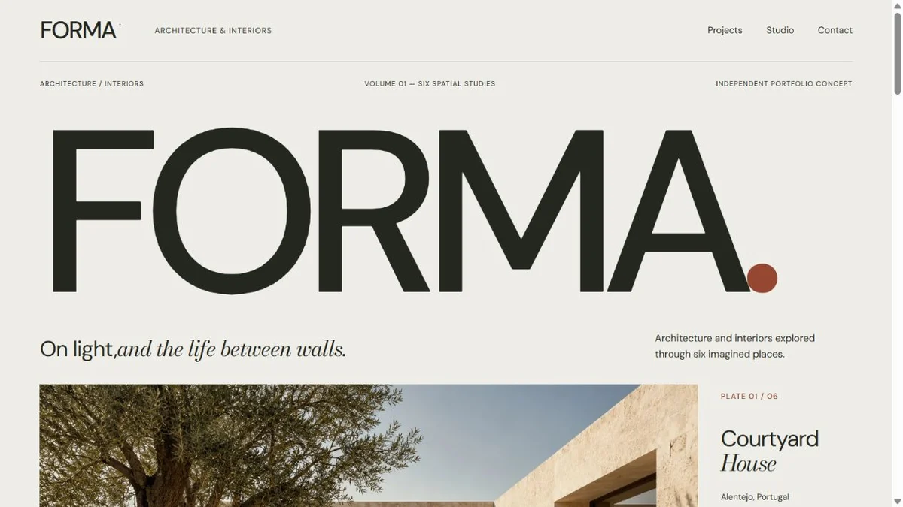

# FORMA Studio

An architecture portfolio concept presented as an editorial monograph, with six fictional projects and responsive image compositions.

[Live demo](https://forma-studio-ui.vercel.app) · [Design notes](DESIGN.md) · [Verification notes](VERIFICATION.md)



## Built with

React · TypeScript · Vite · React Router · Tailwind CSS v4 · Motion · Lucide · Fontsource

## Features

- Homepage, project index, six project detail routes, studio page, and enquiry page.
- Per-project editorial arrangements using courtyard, horizon, and interior composition families.
- Concept/detail image control with a clearly labelled crop of each project's main image.
- Form validation with labelled errors and focus on the first invalid field.
- Responsive navigation, keyboard focus states, reduced-motion support, and native scrolling.

## Implementation notes

| File | Responsibility |
| --- | --- |
| `src/App.tsx` | Route pages, shared navigation, footer, and enquiry form |
| `src/Editorial.tsx` | Cover, editorial plates, project compositions, and image controls |
| `src/data.ts` | Typed project content, materials, and image descriptions |
| `src/editorial.css` / `src/styles.css` | Editorial grids, design tokens, responsive layouts, and interaction states |
| `public/images/` | Optimized local WebP concept images |

DM Sans and Bodoni Moda establish the typographic hierarchy; warm paper, dark ink, and oxidised red carry through the layout. Motion focuses on the change between concept and detail views. See [DESIGN.md](DESIGN.md) for the design rationale.

## Run locally

Use Node.js 24 and npm. No environment variables or external services are required.

```sh
npm ci
npm run dev
```

Open the address printed by Vite, normally `http://127.0.0.1:5173`.

```sh
npm run build
npm run preview
```

Vercel deploys pushes to `main`. `vercel.json` configures the `dist/` output and the fallback for direct visits to project routes.

## Verification

```sh
npm run check
npm run format:check
node scripts/verify-render.mjs
npm run build
```

The deployment verification on 12 October 2026 passed TypeScript, the production build, and 11 actual route renders with project-image checks. The render script checks route content; it does not verify browser layout or interactions. See [VERIFICATION.md](VERIFICATION.md) for recorded browser checks and their limits.

## Demo scope and assets

FORMA is a fictional studio. All six architectural projects are concepts; the imagery does not represent completed buildings or professional services. The enquiry form validates entries but **does not send an enquiry**. It has no backend, browser storage, or analytics.

The six architectural images were generated for this project and optimized as local WebP assets. Each detail study is a crop from the main view. Generation prompts and provenance are retained in `assets-source.json`; source image paths in the optimization script refer to the original development machine. Production assets are already included.

DM Sans and Bodoni Moda use the SIL Open Font License, with license files in `public/licenses/`. Lucide uses the ISC license. The screenshot shows the implemented website.
